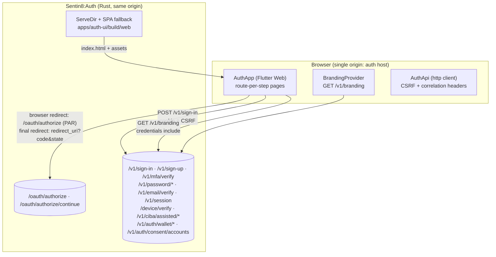

# Sentin8 Auth Hosted UI (auth-ui) - Overview

> Audience: anyone evaluating or onboarding to the Sentin8:Auth hosted sign-in
> experience. For wire-level detail read `DESIGN.md`; for the business view of
> what the UI provides read `BUSINESS.md`.

## 1. Summary

`apps/auth-ui` is the Flutter Web application that renders every human-facing
authentication surface of the platform: sign-in, sign-up, MFA, password reset,
email verification, OAuth consent (including FDX-style account selection),
RFC 8628 device approval, CIBA Assisted Login confirmation, and EUDI wallet
sign-in. It is built as a static Flutter Web bundle and embedded directly in
the Sentin8:Auth Rust server, which serves it from the same hostname as the
OAuth endpoints. All API calls are same-origin against the Auth service's own
`/v1/*` and `/oauth/*` APIs - the app is the auth web tier, not a BFF client.

## 2. Motivation

- **One identity plane needs one sign-in surface.** Sentin8:Auth is the only
  issuer and authentication authority in the platform (architecture
  principles §4.1). A hosted, tenant-brandable UI makes that authority visible
  and consistent for every OAuth client (BFF console, CLI device flow, FDX
  data-sharing consent, CIBA teller flows) without each client building its own
  auth screens or ever handling credentials itself.
- **Credentials must never leave the auth origin.** A same-origin hosted UI
  guarantees that passwords and session cookies are exchanged only with the
  Auth service itself - clients only ever receive the resulting redirect
  (`code` / `state`) at their `redirect_uri`. This removes the entire class of
  token-leak risks that client-side auth forms introduce.
- **Tenant branding at the front door.** Every environment wants its own
  logo, colors, and sign-in text. Fetching branding at startup from
  `GET /v1/branding` (cookie-scoped by TLS context headers) lets a single
  build serve all tenants.
- **Browser-only, zero-backend build complexity.** The app is pure Flutter
  Web rendered as static files - no server-side rendering, no per-tenant
  builds, no runtime configuration beyond branding.

## 3. Architecture & High-Level Design

The Auth Rust server serves both the UI (static files, SPA fallback to
`index.html`) and the API on one origin. The app renders one page per auth
step, driven by the browser URL; every completed step round-trips the OAuth
context (`client_id`, `redirect_uri`, `state`, `code_challenge`, `scope`) to
the next page or back into `/oauth/authorize/continue`.

- **Route-per-step.** Each step is a distinct browser path (`/sign-in`,
  `/consent`, `/device`, …). Navigation between steps is a full page load, so
  query parameters carry state and browser history stays aligned with the
  OAuth redirect model.
- **Same-origin API.** `AuthApi` resolves its base URL from
  `web.window.location.origin`; there is no backend-host configuration at all.
- **Branding at startup.** `BrandingScope` performs a non-blocking
  `GET /v1/branding` fetch; the UI renders with platform defaults and updates
  when branding arrives.

## 4. Key Traits and Data Structures

* `AuthApi` (`lib/api.dart`): the single HTTP boundary of the app. Encapsulates
  header policy (`content-type`, `x-sentin8-correlation-id`, `x-sentin8-csrf`
  when a session token id is known), tolerant JSON decoding, and typed
  exceptions (`AuthApiException` with `statusCode`/`message`). Response DTOs
  (`SignInResponse`, `SignUpResponse`, `SessionResponse`) map the small subset
  of Auth payloads the UI consumes.
* `Branding` / `BrandingScope` / `BrandingProvider`
  (`lib/branding_provider.dart`): the one cross-widget state holder, an
  `InheritedWidget` supplying tenant branding to every page.
* Pages (`lib/pages/*`): one stateful widget per browser route; each owns its
  local form state and error banner. OAuth context is passed as constructor
  arguments parsed from the browser URL.
* `Sentin8Colors` / `Sentin8Text` / `Sentin8Spacing` / `sentin8ThemeForBranding()`
  (`lib/theme.dart`): the design-system layer - 4px grid, Royal Gold accent,
  dark/light palettes, glass panels, and shared widgets (`GlassPanel`,
  `Sentin8Logo`, `ErrorBanner`, `SuccessBanner`, `LoadingSpinner`).
* `AuthUiLogger` / `AuthUiMetrics` / `AuthUiAlerts`
  (`lib/observability.dart`): client-side observability - a correlation id on
  every request, an in-memory log ring buffer, per-flow success/latency
  counters, and sliding-window alert thresholds.
* `registerTestBridge()` (`lib/test_bridge.dart`): e2e automation entry points
  (`window.sentin8TestSignUp/SignIn/Navigate`) that invoke the same widget code
  as the UI buttons - automation never bypasses the UI by calling the API.

## 5. Rationale, Trade-offs, and Alternatives

* **Embed in the Auth server instead of a separate web host.** One origin means
  cookies are first-party, CSRF applies uniformly, and OAuth redirect loops
  never leave the auth domain. Rejected alternative: serving the UI from
  Sentin8:Web (as dash is) - that would host a credentials-collecting page
  under a client-style frontend surface rather than inside the identity
  service itself.
* **Route-per-step with full page loads instead of an SPA router.** OAuth
  already treats the browser as the state carrier (`state`, `code_challenge`).
  Fresh page loads make each step restartable, linkable, and trivially aligned
  with the backend's redirect logic. Rejected alternative: an in-app navigator -
  it would need to re-implement browser redirect targets
  (`redirect_uri?code=...`) as synthetic routes.
* **`setState` + `InheritedWidget` instead of a state-management package.** The
  app has exactly one shared value (branding); every other state lives inside
  a single page's lifecycle. Adding Riverpod/Bloc would be overhead without
  benefit.
* **Memory-only CSRF token id.** The session token id used to arm
  `x-sentin8-csrf` is kept only for the lifetime of the page that fetched it.
  The durable session lives entirely in the Auth server cookie session.
  Rejected alternative: persisting tokens in web storage - unnecessary and
  weaker than the HttpOnly cookie.
* **Raw `web.window.fetch` for branding, `http` for the API.** Branding must be
  fetched independently of `AuthApi` construction, always with
  `credentials: 'include'`, and must never fail startup; the dedicated API
  client normalizes everything else.
* **Flutter CanvasKit + semantics.** Enabling `SemanticsBinding` produces real
  DOM elements with ARIA labels, which is what automated browser testing and
  assistive technology drive. Trade-off: a slightly larger bundle in exchange
  for testability and accessibility.

## 6. Internal Implementation & Invariants (Private Design)

* **Invariants:**
  - Every request the UI issues goes to `window.location.origin` - no
    cross-origin API calls, no configurable backend host.
  - Password material exists only inside a page's form controllers and the one
    POST body that consumes it; it is never logged or persisted.
  - OAuth context (`client_id`, `redirect_uri`, `state`, `code_challenge`,
    `scope`) is round-tripped across every navigation between auth pages -
    losing it would strand the user outside their originating flow.
  - Sign-up never auto-completes an OAuth authorization; the browser is sent
    back through `/oauth/authorize` (protected authorization requests) to
    mint the code.
  - `POST /v1/password/reset-request` always reports success, never revealing
    whether the email exists.
  - The CSRF header is armed only from a session token id obtained in the same
    page session.
  - Correlation ids are fresh per browsing session and travel on every request.
* **Browser quirks handled in-code:** Flutter's `initialRoute` strips query
  parameters, so pages re-read `window.location.search`; a deferred session
  check works around a Flutter-web `initState` synchronous-HTTP stall; the
  dart2js RNG avoids `1 << 32` (which JavaScript wraps).
* **Consent account selection** is fetched only when a `consent_flow` parameter
  is present; the account list arrives pre-selected with All/None controls and
  is forwarded as `selected_account_ids` on approval.

## 7. Unresolved Questions / Future Designs

- Sign-out: `AuthApi` implements `POST /v1/sign-out` but no page invokes it;
  a sign-out affordance on the hosted UI is not part of any flow yet.
- Enterprise SSO (SAML/OIDC) is surfaced as an inactive button stub on the
  sign-in page.
- `PasskeyEnrollPage`/`PasskeyVerifyPage` exist in the codebase but are not
  routed; WebAuthn passkeys are not reachable from the hosted UI today.
- `AccountRecoveryPage` is an explainer placeholder; MFA-authenticator recovery
  is not wired to a backend endpoint yet.
- Tenant `customCss` is fetched and parsed but not applied; the UI renders
  with its compiled theme plus branding color/font/logo overrides only.
- The consent page does not yet consume the server-side RFW consent UI
  definition; it renders its own native layout.

---

**Architecture & Design:** sentin8:auth-ui and its underlying concepts were designed by [Hamid Jahanzad](https://www.linkedin.com/in/hamidjahanzad/).
